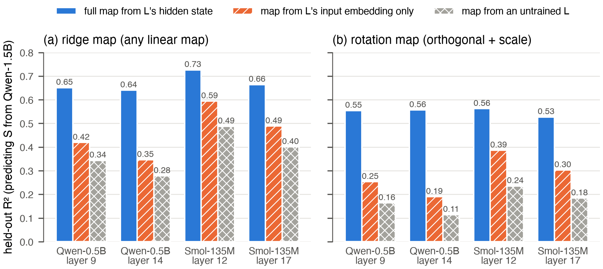
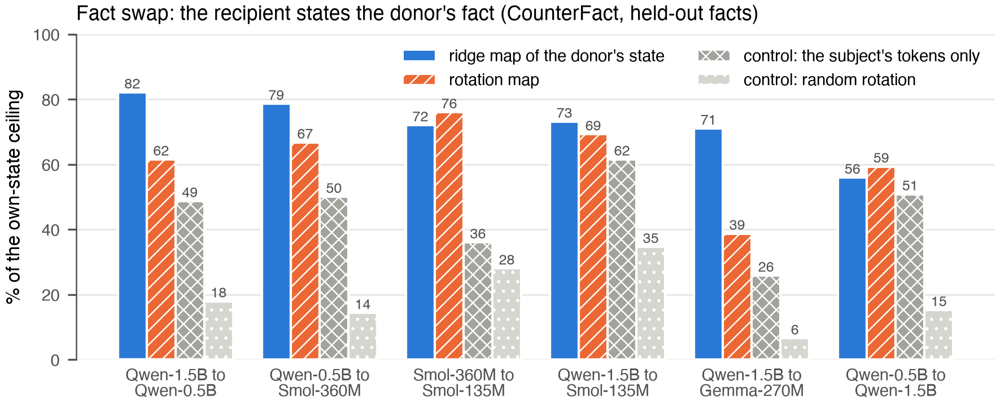
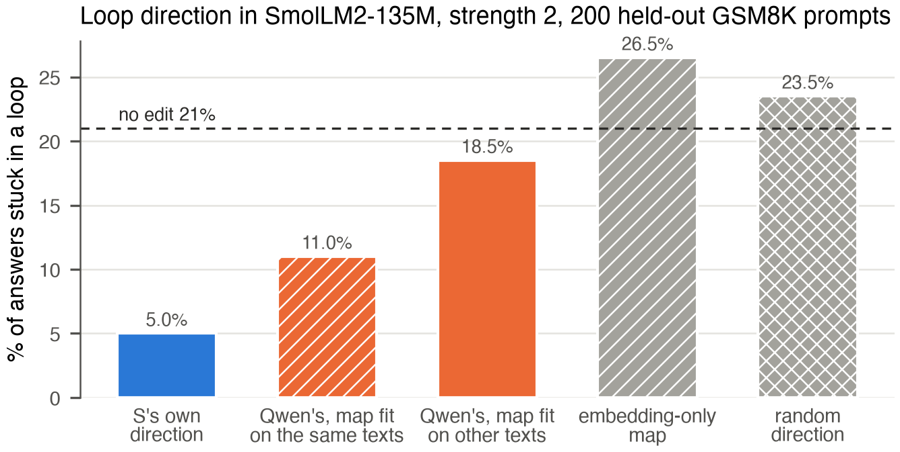
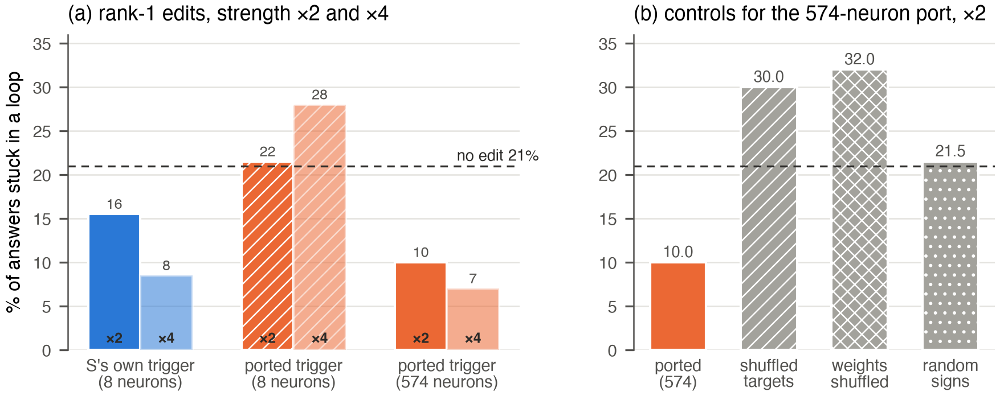
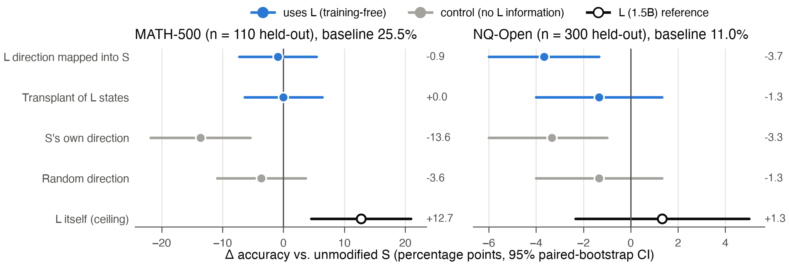
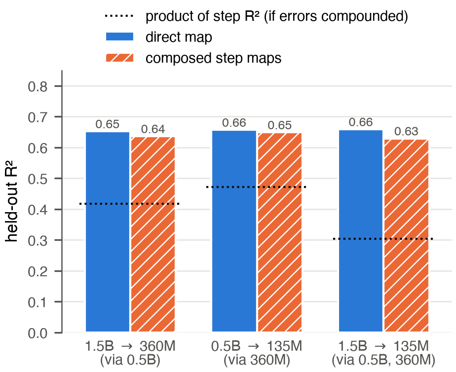

# weightmap

**Training-free linear maps between small and large language models.**

When two language models read the same text, each turns every token into a vector, its hidden state. This repository asks whether the small model's hidden state can be computed from the large model's by one linear map, fitted in a single closed-form step with no training. It also asks whether that map can transfer anything from the large model into the small one: states, facts, behaviours, weight edits, or ability. We test six models from four families, between 135M and 1.5B parameters (Qwen2.5, SmolLM2, Gemma-3, Pythia).

The short answer: whole hidden states and some facts transfer, a large part of the map is the shared token, and compact objects do not transfer. A single steering direction and an 8-neuron weight edit do not carry over. A dense weight edit does.

**Write-up:** the technical report, with interactive figures and a short plain-language version, is at <https://nishparadox.com/research/weightmap/>. The full experiment log, with every table and the threats to validity, is [`docs/EXPERIMENTS.md`](docs/EXPERIMENTS.md).

## Background

The work continues [ConceptGate](https://doi.org/10.5281/zenodo.24287378), which reads and steers concepts inside one frozen model, and was prompted by [*Sparks of Weight-Space Programming*](https://rikiyat.github.io/blog/weight-space-programming/) (Takehi et al., MIT, Nov 2026), in which an LLM reads and edits a small network's weights directly. Both work inside a single model. Here we ask whether a map between two models can move such an edit, or the ability behind it, from one model to the other.

Despite the name, the map is in **activation space**: hidden states at tokens that both models have read. The raw weights of models with different widths cannot be compared directly, because the dimensions differ and the weights have permutation and rotation symmetries. The weight-space part of the project is the transfer of weight edits (`fold()` and the rank-1 port in [`scripts/lp_port.py`](scripts/lp_port.py)).

| | Hypothesis |
|---|---|
| **H1** | Models of different sizes occupy related regions of a shared space. |
| **H2** | A map **F** exists between the small model's space (S) and the large model's (L). |
| **H3** | S is contained in L. |
| **H4** | F carries ability from L into S, without training. |
| **H5** | The maps compose: tiny → small → large. |

## Results

| Claim | Result | Evidence |
|---|---|---|
| H1, H2: a map exists | Yes, for representations | Held-out R² 0.64–0.73. L's input embeddings alone give 0.35–0.59 (Figure 1) |
| H3: containment | Mostly, in behaviour | L solves 82% of S's MATH problems and 62% of its NQ answers. Its overall accuracy is 42% and 12% |
| H4: ability transfers | No | MATH −0.9 points [95% CI −7.3, +5.5]. 0 of 9 problems that S never solves were fixed |
| H5: composition | Yes for prediction, unclear for behaviour | R² keeps 95% along a 3-step chain. Fact swap through the chain keeps 53–78% of the direct result, not significant at n = 86 |
| Facts transfer | Partly | 56–82% of the own-state ceiling. The subject's tokens alone give 26–62% (Figure 2) |
| A steering direction transfers | No | Through a map fitted on other texts: loops 18.5% against 21% with no edit (Figure 3) |
| A transplanted block transfers | No | A block mapped in from L is worse than deleting the block |
| Weight edits transfer | Only when dense | An 8-neuron trigger does not port. A 574-neuron trigger cuts loops from 21% to 10%; three unselective controls give 21.5–32% (Figure 4) |
| S looks like a pruned L | Yes | 896 of L's 1,536 coordinates predict S as well as all of them (0.641 vs 0.638); a random 896 lose 0.06 |
| The map is linear | Yes | Adding non-linear features does not help (−0.03) |

### Figure 1. Much of the map is the shared token



A map from Qwen-1.5B's hidden state predicts 0.64–0.73 of the small model's hidden state on held-out texts. A map from Qwen-1.5B's input embedding, which only knows which token is present, already gets 0.35–0.59. A map from an untrained copy of Qwen-1.5B gets 0.28–0.49. The part that comes from what the large model computes is the gap between the blue and orange bars: 0.13–0.29 for ridge and 0.18–0.37 for a rotation. Any claim about a shared representation needs this control. ([`scripts/rotation_vs_ridge.py`](scripts/rotation_vs_ridge.py))

### Figure 2. Facts move with the hidden state



We take a CounterFact prompt, map the donor model's hidden state at the last subject token, and write it into the recipient on a prompt about a different subject. The bars show how often the recipient then states the donor's fact, as a share of the result when the recipient's own state for that subject is written in. The ridge map reaches 56–82%. The control that only gives the recipient the subject's tokens reaches 26–62%, so part of the effect is token identity. The map is above that control in every pair, but the gap is not significant in each pair alone. ([`scripts/fact_swap.py`](scripts/fact_swap.py))

### Figure 3. A single steering direction does not transfer



We take the "looping minus productive" direction from Qwen-1.5B and map it into SmolLM2-135M. When the map is fitted on the same texts that define the direction, the mapped direction cuts loops to 11%. That result is circular: the map has already seen the labels. With a map fitted on other texts, loops are 18.5% against 21% with no edit, and the direction's cosine with S's own direction (0.82) is within the range of random relabellings (0.51–0.85). Qwen-1.5B itself does not loop on these prompts. ([`scripts/loop_controls.py`](scripts/loop_controls.py))

### Figure 4. Weight edits transfer only in dense form



A rank-1 edit `ΔW = δ u vᵀ` fires when the trigger `v·a` is large, and writes S's own loop direction `u`. A linear program finds S's own sparse trigger, in 8 neurons, which reduces loops. Porting L's trigger into 8 of S's neurons does nothing (a). Porting it with no limit on the number of neurons gives 574 neurons and cuts loops from 21% to 10%. Three controls over the same neurons do not (b): the same program on shuffled targets, the real weights shuffled over the neurons, and the real weights with random signs. The selective information is spread over many neurons. ([`scripts/lp_port.py`](scripts/lp_port.py), `DENSE=1` and `FOLLOWUP=1..3`)

### Earlier figures

The first experiment (Qwen2.5-0.5B ↔ 1.5B, MATH-500 and NQ-Open) and the atlas across five small models:





One measurement note. Experiment 1 first reported R² 0.85 because it fitted and scored on chat-formatted text, where the system prompt and template tokens repeat in every example and are easy to map. On answer text with whole texts held out, the value is 0.66. See [*Measurement check*](docs/EXPERIMENTS.md#56-measurement-check-text-level-holdout-template-tokens-layer-pairing).

**In one line:** a map between models transfers information in distributed form (whole states, facts at a token, a dense weight edit) and fails for compact objects (one direction, a sparse edit, a block). It does not add ability that the small model lacks.

**Concurrent work.** [*Plato's Key*](https://hazyresearch.stanford.edu/blog/2026-11-25-platos-key) (Hazy Research, 25 Nov 2026) appeared while this work was in progress and studies similar maps between models. Figures 1 and 2 run its two central tests, rotation against ridge and the fact swap, on our models with the token-identity controls added.

## Install

```bash
uv sync                      # library only (torch, transformers, numpy)
uv sync --extra experiments  # + datasets, math-verify, matplotlib for scripts/
```

## Usage: finding and using the L ↔ S map

The workflow has five steps: **discover** the map, **check** that it is real, **translate** between the models, **test** whether L helps S on your task, and **keep** what works.

### 1. Discover the map

```python
from weightmap import WeightMap

# hub ids, local paths, loaded models, or (model, tokenizer) pairs
wm = WeightMap(large="Qwen/Qwen2.5-1.5B-Instruct", small="Qwen/Qwen2.5-0.5B-Instruct")

# any text both models can read; in-domain text gives better maps
wm.fit(texts, layers=[10, 14])
```

`fit` does two passes:
1. It runs both models on the same texts, computes linear CKA between **every** small layer and **every** large layer, and pairs each small layer with its most similar large layer (`wm.layer_match`, `wm.cka`). Pass `pair_by="r2"` to pair by held-out predictability instead. It is slower and, so far, gives the same map quality.
2. For the requested layers, it fits closed-form ridge maps **L→S** and **S→L** on hidden states at aligned tokens, and scores them on **held-out texts** (`holdout_by="text"`, the default; `"token"` is available but optimistic).

Nothing is trained.

### 2. Check that the map is real

```python
for row in wm.report():
    print(row)
# {'small_layer': 10, 'large_layer': 13, 'cka': 0.913, 'r2_large_to_small': 0.664,
#  'r2_small_to_large': 0.621, 'r2_shuffled_control': -0.154, 'r2_small_prev_layer': 0.914,
#  'holdout_by': 'text', 'pair_by': 'cka', ...}
```

(Real output: Qwen2.5-0.5B ↔ 1.5B, fitted on 520 MATH/NQ answer texts. Fit on content text rather than chat-templated prompts: repeated boilerplate tokens inflate R².)

| Field | Meaning | What to look for |
|---|---|---|
| `large_layer` | L layer that best matches this S layer (CKA) | Rises with `small_layer`, meaning the models process in the same order |
| `cka` | Linear CKA between the paired layers | High (> 0.8), but inflated by token identity, so don't rely on it alone |
| `r2_large_to_small` | Held-out R² predicting S's states from L's | The main evidence: how much of S is linearly recoverable from L |
| `r2_small_to_large` | The reverse | If clearly lower than L→S, S looks "contained in" L |
| `r2_shuffled_control` | The same fit with token pairing broken | Should be ≤ 0. If it isn't, the map isn't using token correspondence |
| `r2_small_prev_layer` | S's layer ℓ−1 predicting layer ℓ | A ceiling for "as related as adjacent layers of one model" |

To see the full layer correspondence:

```python
import matplotlib.pyplot as plt
plt.imshow(wm.cka.T, origin="lower", aspect="auto"); plt.xlabel("small layer"); plt.ylabel("large layer")
```

### 3. Translate between the models

```python
h_small_hat = wm.to_small(h_large, layer=10)   # L's states (at L layer wm.layer_match[10]) -> S space
h_large_hat = wm.to_large(h_small, layer=10)   # S -> L
d_small     = wm.transport(d_large, layer=10)  # a *direction* (difference vector): linear part only
```

### 4. Test whether L helps S on your task

This is the experiment-1 protocol in a few lines. Use problems that **L gets right and S gets wrong**. Build a "correct vs. wrong" direction in **L's** space, transport it into S, and compare it with S's own direction and a random one.

```python
import torch
# prompts / l_correct / s_wrong / test_prompts come from your task; accuracy() is your grader
pos = [p + l_answer for p, l_answer in zip(prompts, l_correct)]   # L's correct answers
neg = [p + s_answer for p, s_answer in zip(prompts, s_wrong)]     # S's wrong answers
start = [len(p) for p in prompts]                                 # average over the answer only

lay = 10
d_L = wm.transport(wm.contrast_direction(pos, neg, wm.layer_match[lay], which="large", start_chars=start), lay)
d_S = wm.contrast_direction(pos, neg, lay, which="small", start_chars=start)
scale = d_S.norm()                                                 # same size for every method -> fair

for name, d in {"L->S": d_L, "S-native": d_S, "random": torch.randn_like(d_S)}.items():
    outs = wm.generate(test_prompts, steer=(d / d.norm() * scale * 2, lay))
    print(name, accuracy(outs))

# per-problem alternative: mix L's mapped prompt states straight into S (needs L at inference time)
outs = wm.generate(test_prompts, transplant_layer=14, beta=0.5)
```

If `L->S` beats `S-native` and `random` on held-out problems, the map carries information from L that S lacks. In experiment 1 it didn't (see the conclusion above).

### 5. Keep what works

```python
handle = wm.fold(d_L / d_L.norm() * scale * 2, layer=lay)   # write the steering vector into S's weights
wm.small.save_pretrained("small-edited")                    # an ordinary HF checkpoint
handle.undo()                                               # or restore the original weights

wm.save("map.pt")                                           # reuse a fitted map later
wm = WeightMap.load("map.pt", large="Qwen/Qwen2.5-1.5B-Instruct", small="Qwen/Qwen2.5-0.5B-Instruct")
```

### Different tokenizers (cross-family)

```python
wm = WeightMap(large="Qwen/Qwen2.5-1.5B-Instruct", small="HuggingFaceTB/SmolLM2-360M")
wm.shared_vocab   # False: tokens are aligned automatically
wm.fit(texts)
```

Tokens are paired where both tokenizers have a token **ending at the same character**, which is exactly where both causal models have read the same text prefix. With identical tokenizers, every position is paired. Both tokenizers must be "fast" tokenizers, since character offsets are required.

**Supported models:** HF decoder-only causal LMs with a `layers` / `h` / `blocks` module list. `fold()` needs a Llama/Qwen-style `mlp.down_proj`. On Apple Silicon, cap GPU memory with `PYTORCH_MPS_HIGH_WATERMARK_RATIO=0.4 PYTORCH_MPS_LOW_WATERMARK_RATIO=0.3`.

## Layout

```
weightmap/              the library
  core.py               WeightMap: fit / report / to_small / transport / steer / generate / fold / save
  align.py              cross-tokenizer alignment by shared character boundaries
  linalg.py             linear CKA, closed-form ridge, R^2
  models.py             model resolution, hidden states, layer hooks
tests/                  pytest suite (tiny random models, CPU, ~5 s)
scripts/                one-off experiments; each writes a .log and a *_results.json next to it
  exp1_qwen_0.5b_1.5b/  experiment 1: stages s1–s5, figures, cached results
  atlas_recursion.py    five small models, composed maps
  rotation_vs_ridge.py  rotation vs ridge, with the token-identity controls (Figure 1)
  fact_swap.py          fact transfer by hidden-state swap (Figure 2)
  loop_controls.py      controls for the mapped loop direction (Figure 3)
  lp_port.py            rank-1 weight edit and its port from L (Figure 4)
  block_transplant.py   mapping a whole block from L into S
  tiny_venn.py          which problems tiny, small and large models solve
  fig_readme.py         Figures 1–4 above, from the saved results
docs/
  EXPERIMENTS.md        full experiment log
  math.html             the maths, step by step, with worked examples
  notebook.html         tutorial notebook
  figures/              figures (PDF + PNG, colour-blind safe)
```

## Tests

```bash
uv run pytest -q
```

## Status

Research code, run on a laptop. The models are small (135M–1.5B parameters). The loop tests use 200 prompts and the fact swaps 86–126 facts per pair, and several pairwise differences are not significant alone. The limitations and next steps are in the [report](https://nishparadox.com/research/weightmap/) and in [`docs/EXPERIMENTS.md`](docs/EXPERIMENTS.md).

## Citation

```bibtex
@misc{pantha2026weightmap,
  author       = {Pantha, Nishan},
  title        = {Weightmap: Training-Free Linear Maps Between Small and Large Language Models},
  year         = {2026},
  month        = nov,
  howpublished = {\url{https://nishparadox.com/research/weightmap/}},
  note         = {Technical report}
}
```
