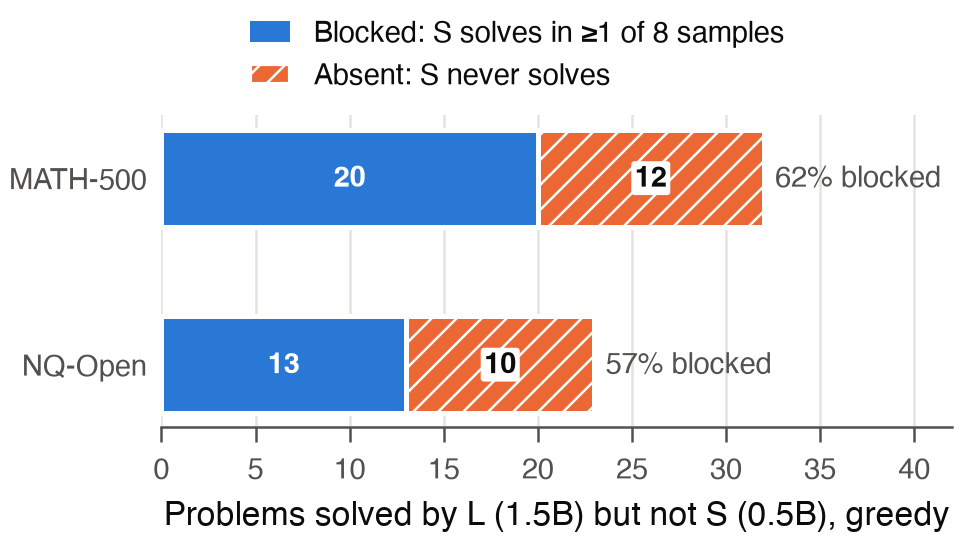
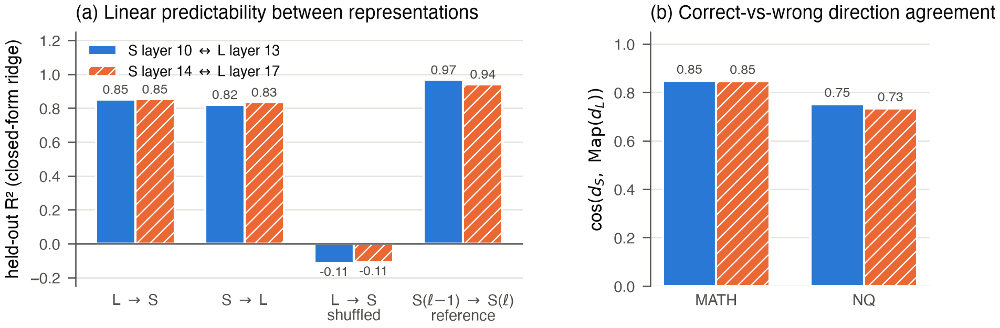
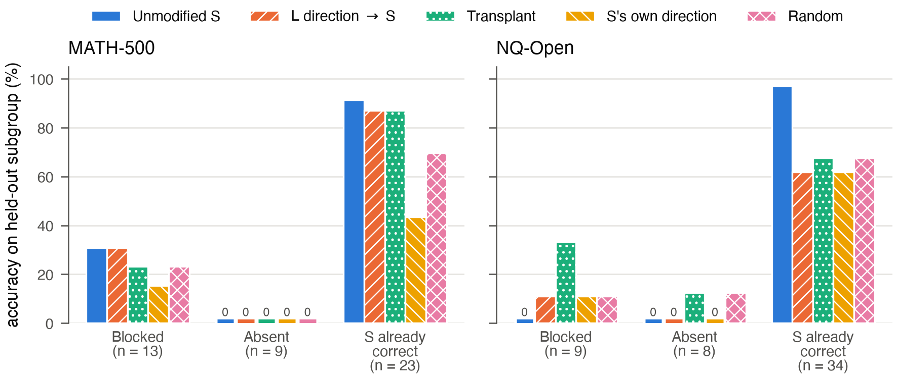

# Experiments: Can a training-free map from a larger model's representations improve a smaller model?

*Experiment 1: Qwen2.5-0.5B-Instruct (S) ↔ Qwen2.5-1.5B-Instruct (L). Run 2026-11-02 to 11-07 on an Apple M3 Max (36 GB), commit `d107e0c`.*

---

## 1. Motivation

*Sparks of Weight-Space Programming* (Takehi, Teoh, Zhang, Khattab; MIT CSAIL, Nov 2026) shows a frontier LLM ("Astra") reading and editing the weights of small networks directly, with no gradient descent. Its headline LLM result: an edit to 0.016% of Qwen3.5-0.8B's weights removed a looping failure, taking MATH-500 accuracy from 7.9% to 48.1%. The authors conclude that editing "could remove an obstacle that hid an ability, but it could not add an ability the model lacked."

That result prompted the following hypothesis.

## 2. Hypotheses

| ID | Claim |
|---|---|
| **H1** | Models of different sizes occupy related *sets* (regions) of a shared space. They aren't identical points, but they are structurally related. |
| **H2** | There is a map **F** between the small model's space (S) and the large model's space (L). |
| **H3** | S is effectively *contained* in L: L's representation subsumes S's. |
| **H4** | F carries capability-relevant information *from L*, so F can be used to steer or edit S toward problems that only L solves, **without training**. |
| **H5** | Applied recursively (tiny → small → large), the same construction should compose. *(Not tested yet.)* |

**Operationalization.** Raw weight spaces of different-width models aren't directly comparable: different dimensions, plus permutation and rotation symmetries. So every test here works in *representation space*, the residual-stream activations at matched tokens. The two models share a tokenizer, which makes token-level pairing exact.

**Problem-set framing.** Let P_L be the problems L solves and P_S the problems S solves. The target set is P_L \ P_S. It splits into:
- **blocked:** S has the ability but fails to use it reliably. Operationally, S solves the problem in at least 1 of 8 samples.
- **absent:** S never solves it in 8 samples.

H4 predicts that L-derived edits convert target problems into successes. The blog's conclusion predicts that any gains are confined to *blocked* problems.

**Constraint.** No model is trained or fine-tuned. Every step uses forward passes, sampling, or closed-form linear algebra. The only fitted object is a ridge-regression map solved in closed form.

---

## 3. Setup

| | |
|---|---|
| S (small) | `Qwen/Qwen2.5-0.5B-Instruct`: 24 layers, d = 896 |
| L (large) | `Qwen/Qwen2.5-1.5B-Instruct`: 28 layers, d = 1536 |
| Tokenizer | Identical (vocabularies verified equal) |
| Precision / device | bf16 on MPS |
| Reasoning task | MATH. Directions come from `EleutherAI/hendrycks_math` train (120 sampled); evaluation is on `HuggingFaceH4/MATH-500` (150 sampled; no overlap with train) |
| Knowledge task | NQ-Open (`google-research-datasets/nq_open`): 400 train, 400 validation (sampled, seed 0) |
| MATH prompt | System: "Please reason step by step, and put your final answer within \boxed{}." Max 512 new tokens |
| NQ prompt | System: "Answer the question with a short factual answer (a few words). Do not explain." Max 24 new tokens |
| MATH grading | Last `\boxed{}` compared with `math-verify` |
| NQ grading | SQuAD-style normalization; correct if any gold alias is a substring of the first output line |
| Decoding | Greedy for evaluation; temperature 0.8 / top-p 0.95 for the blocked/absent sampling |

The sizes were deliberately small, chosen so the whole pipeline runs in about 15 minutes on a laptop. See §7 for what that costs in statistical power.

---

## 4. Pipeline

| Stage | Script | What it does |
|---|---|---|
| 1 | `s1_generate.py` | Greedy outputs of S and L on all four splits, partitioned into both / L-only (target) / S-only / neither |
| 2 | `s2_latent.py` | For test-split target problems, sample S k = 8 times: blocked (≥1 correct) vs absent (0 correct) |
| 3 | `s3_map.py` | (a) Linear CKA between every S layer and every L layer. (b) Closed-form ridge maps L→S and S→L at S layers {10, 14} paired with their best-CKA L layer, plus controls. (c) Correct-vs-wrong contrast directions |
| 4 | `s4_steer.py` | Training-free edits of S, tuned on a slice of the test split and evaluated on the disjoint remainder |
| 5 | `s5_fold.py` | Folds the best static edit into S's weights and verifies equivalence |
| – | `make_figures.py` | Paper figures (PDF + PNG) in `docs/figures/` |

### 4.1 Representation map (stage 3)

- **Data:** L's own outputs on the train splits (520 texts in chat format), run through both models. Both models see identical token positions; 40 positions per text are sampled.
- **Filtering:** attention-sink / massive-activation tokens are dropped (norm > 5× median at the middle layer in either model), and 15,000 tokens are kept.
- **CKA:** linear CKA on 5,000 tokens, for all 23 × 27 layer pairs (final normed layers excluded).
- **Ridge maps:** fitted in both directions; λ ∈ {1e-4 … 1e-1} × mean feature variance, chosen on an 80/20 token split. The report gives held-out R² (variance-weighted).
- **Controls:**
  - *Shuffled:* the token pairing is broken by permuting rows. This tests whether the map relies on token-level correspondence.
  - *Reference:* predicting S's layer ℓ from S's own layer ℓ−1. This is a ceiling for "highly related."

**Contrast directions.** Use the train-split target problems: 21 for MATH and 25 for NQ. Each has a positive text (prompt + L's correct answer) and a negative text (prompt + S's wrong answer). Representations are averaged over completion tokens, then over problems.
- `d_S = mean_S(pos) − mean_S(neg)`, encoded by S.
- `d_L→S = Map_{L→S}(mean_L(pos) − mean_L(neg))`, encoded by L and mapped with the linear part of the ridge map.

The texts are identical for both; only the encoder differs. So any advantage of `d_L→S` over `d_S` has to come from information in L's representation.

### 4.2 Edits (stage 4)

Every edit is applied to S at a single decoder-layer output (the residual stream).

| Condition | Edit |
|---|---|
| base | none |
| S-native | add `c · ‖d_S‖ · unit(d_S)` at every position |
| L→S | add `c · ‖d_S‖ · unit(d_L→S)`, the same norm as S-native |
| random | add `c · ‖d_S‖ · unit(N(0, I))`, at the same layer and scale as the best L→S setting |
| transplant | per problem, run L on the prompt and map its layer states into S: `h ← (1−β)·h + β·Map(h_L)` at prompt positions during prefill, sink tokens excluded. L is needed at inference time, so this isn't a static edit |
| L (ceiling) | L's own greedy answers |

- **Grid:** layer ∈ {10, 14}; c ∈ {1, 2, 4}; β ∈ {0.5, 1.0}.
- **Tuning:** a random slice of the test split (MATH 40 problems, NQ 100), selecting by accuracy on that slice. The report uses the disjoint remainder (MATH 110, NQ 300).
- **Statistics:** 95% CIs come from a paired bootstrap (5,000 resamples) of per-problem differences against base.

---

## 5. Results

### 5.1 Stage 1: accuracy and partition

| Split | n | S acc | L acc | Both | **L only (target)** | S only | Neither |
|---|---|---|---|---|---|---|---|
| MATH train | 120 | 29.2% | 40.8% | 28 | **21** | 7 | 64 |
| MATH-500 test | 150 | 20.7% | 38.7% | 26 | **32** | 5 | 87 |
| NQ train | 400 | 5.2% | 10.0% | 15 | **25** | 6 | 354 |
| NQ test | 400 | 10.0% | 12.0% | 25 | **23** | 15 | 337 |

Absolute MATH numbers are below published figures because of the 512-token cap: long solutions get truncated. The cap is the same for every condition, so comparisons between conditions are unaffected.

### 5.2 Stage 2: blocked vs absent (H-precondition)



| Task | Target | Blocked (pass@8 > 0) | Absent | % blocked |
|---|---|---|---|---|
| MATH-500 | 32 | 20 | 12 | **62.5%** |
| NQ-Open | 23 | 13 | 10 | 56.5% |

Most of the S/L gap on MATH is *latent* in S. The NQ figure is an upper bound: short answers (years, common names) can be hit by chance across 8 samples.

### 5.3 Stage 3: is there a map? (H1, H2, H3)


**CKA.** The best-matching L layer for each S layer rises almost monotonically:

`{0:0, 1:2, 2:3, 3:6, 4:7, 5:7, 6:7, 7:12, 8:12, 9:13, 10:13, 11:16, 12:17, 13:15, 14:17, 15:18, 16:19, 17:20, 18:21, 19:21, 20:21, 21:25, 22:25}`

The peak CKA per S layer is 0.92–0.94 for layers 0–15, falling to 0.81 at layer 22. So representations agree most in early and middle layers and diverge toward the output.



| S layer ↔ L layer | CKA | R² L→S | R² S→L | R² L→S shuffled | R² S(ℓ−1)→S(ℓ) |
|---|---|---|---|---|---|
| 10 ↔ 13 | 0.927 | **0.851** | 0.820 | −0.113 | 0.966 |
| 14 ↔ 17 | 0.921 | **0.852** | 0.834 | −0.108 | 0.941 |

**Direction agreement**, `cos(d_S, Map(d_L))`:

| Task | Layer 10 | Layer 14 |
|---|---|---|
| MATH | 0.847 | 0.846 |
| NQ | 0.752 | 0.734 |

Norms for context: at layer 10, ‖d_S‖ = 0.55 on MATH and 1.84 on NQ, against a median residual-stream norm of about 15.1.

**Reading.**
- **H2, a map exists: strongly supported.** A single linear map explains 85% of S's state variance from L's state at the same token. Breaking the token pairing drives R² negative.
- **H1, related sets: supported** in representation space. Layer order is preserved, and the map approaches the S-to-itself reference.
- **H3, S contained in L: weak.** L→S beats S→L by only 0.02–0.03 R². Predicting a wider target is somewhat harder anyway, so this asymmetry is not strong evidence.
- Stage 4 adds evidence for H2: replacing S's layer-14 prompt states entirely (β = 1) with *mapped L states* leaves S solving MATH at its normal rate (22.5% vs a 30% tune baseline; see 5.4). So the translated representation is usable by S's downstream layers.

### 5.4 Stage 4: does the map transfer capability? (H4)

**Tuning slice** (MATH n = 40, NQ n = 100). The MATH tune baseline was generated at batch size 64; all other runs used 32. See §7.

| Config | MATH | NQ |
|---|---|---|
| base | 0.300 | 0.070 |
| S-native L10 ×1 / ×2 / ×4 | 0.200 / 0.200 / 0.225 | 0.08 / 0.06 / 0.02 |
| S-native L14 ×1 / ×2 / ×4 | 0.225 / 0.200 / 0.200 | 0.06 / 0.04 / 0.01 |
| L→S L10 ×1 / ×2 / ×4 | 0.175 / **0.325** / 0.225 | **0.08** / 0.07 / 0.02 |
| L→S L14 ×1 / ×2 / ×4 | 0.275 / 0.225 / 0.225 | 0.07 / 0.04 / 0.02 |
| transplant L10 β .5 / 1 | 0.200 / 0.225 | **0.09** / 0.06 |
| transplant L14 β .5 / 1 | **0.250** / 0.225 | 0.08 / 0.07 |

**Selected configurations.**
- MATH: S-native (L10, ×4), L→S (L10, ×2), transplant (L14, β = 0.5), random (L10, ×2).
- NQ: S-native (L10, ×1), L→S (L10, ×1), transplant (L10, β = 0.5), random (L10, ×1).

An earlier grid scaled edits to 25–50% of the residual norm, roughly 7–14× the natural ‖d_S‖. It collapsed MATH accuracy to 2.5–5% and was discarded (§7).


**Held-out test, all problems.**

| Condition | MATH acc (n = 110) | Δ [95% CI] | NQ acc (n = 300) | Δ [95% CI] |
|---|---|---|---|---|
| base | 25.5% | – | 11.0% | – |
| **L→S direction** | 24.5% | −0.9 [−7.3, +5.5] | 7.3% | −3.7 [−6.0, −1.3] |
| **transplant** | 25.5% | +0.0 [−6.4, +6.4] | 9.7% | −1.3 [−4.0, +1.3] |
| S-native direction | 11.8% | −13.6 [−21.8, −5.5] | 7.7% | −3.3 [−6.0, −1.0] |
| random direction | 21.8% | −3.6 [−10.9, +3.6] | 9.7% | −1.3 [−4.0, +1.3] |
| L itself (ceiling) | 38.2% | +12.7 [+4.5, +20.9] | 12.3% | +1.3 [−2.3, +5.0] |



**Held-out subgroups.** Groups are defined from stage 1/2 labels.

| Task | Group | n | base | L→S | transplant | S-native | random | L |
|---|---|---|---|---|---|---|---|---|
| MATH | blocked | 13 | 30.8% | 30.8% | 23.1% | 15.4% | 23.1% | 100% |
| MATH | absent | 9 | 0% | 0% | 0% | 0% | 0% | 100% |
| MATH | S already correct | 23 | 91.3% | 87.0% | 87.0% | 43.5% | 69.6% | 87.0% |
| NQ | blocked | 9 | 0% | 11.1% | 33.3% | 11.1% | 11.1% | 100% |
| NQ | absent | 8 | 0% | 0% | 12.5% | 0% | 12.5% | 100% |
| NQ | S already correct | 34 | 97.1% | 61.8% | 67.6% | 61.8% | 67.6% | 58.8% |

**Reading.**
- **H4, L-derived edits improve S: not supported.** On MATH, the L→S direction and the transplant are *harmless* (Δ ≈ 0) but never beneficial. On NQ the L→S direction is mildly harmful.
- **The L-derived edit is safer than S's own direction.** On MATH, at the selected strengths, L→S keeps 87% of S's already-correct problems against 43.5% for S-native. But the two directions have cosine 0.85 and were selected at different strengths (×2 vs ×4), so this mostly reflects strength, not a qualitative difference.
- **Absent problems: none fixed on MATH** by any method (0/9). On NQ, transplant and random each fix 1/8, which is chance-level for short answers.
- **The NQ blocked-group gain for transplant (3/9) is not evidence.** n is 9, random also scores 1/9, and NQ "blocked" is chance-inflated (§5.2).

### 5.5 Stage 5: the edit as a weight edit

The best static L→S vector folds exactly into S as a bias on layer 10's `mlp.down_proj`. That changes 896 parameters, 0.00018% of S.

| Check | Max abs logit difference vs. hook |
|---|---|
| bf16 | 0.81 (MATH), 0.58 (NQ): rounding from a different summation order |
| **fp32** | **1.4 × 10⁻⁴**, with logit scale ≈ 32 |

The folded checkpoints are written to `results/S_edited_{math,nq}/`. They are git-ignored at 953 MB each, and since they improve nothing, they can be deleted.

---

## 6. Conclusion

| Hypothesis | Verdict | Key evidence |
|---|---|---|
| Precondition: much of P_L \ P_S is latent in S | **Supported** | 62.5% of MATH targets are blocked |
| H1: related sets | **Supported** (representation space) | Monotone CKA layer correspondence; CKA ≈ 0.92 |
| H2: a map F exists | **Strongly supported** | R² 0.85 vs −0.11 shuffled; transplanted states remain usable by S |
| H3: S contained in L | **Weak** | L→S 0.85 vs S→L 0.82–0.83 |
| H4: F transfers capability without training | **Not supported** (at this scale and method) | L→S Δ −0.9 [−7, +5] (MATH), −3.7 [−6, −1] (NQ); 0/9 absent fixed |
| H5: recursion | Not tested | – |

**Interpretation.** F behaves like a faithful translation, not an upgrade. L's correct-vs-wrong direction, projected into S, is close to S's own (cos 0.85). Whatever in L's representation has no counterpart in S's coordinates is discarded by the projection, and that is plausibly the part that makes L better.

This agrees with the blog's "unlock, don't add" conclusion. It also suggests that Astra's edits came from reasoning plus experimentation (its forward-pass budget), not from an implicit cross-scale weight map.

---

## 7. Threats to validity and engineering notes

1. **Small n.** About 22 target problems per task and 110/300 held-out problems. The CIs exclude large effects (e.g. > +6 points on MATH for L→S), not small ones.
2. **Batch-order nondeterminism.** bf16 greedy decoding on MPS depends on batch composition and padding. The same S re-run scored 91–97% on problems it solved in stage 1, and 30.8% on MATH "blocked" problems it got wrong in stage 1. So differences under about 6 points are within noise. The MATH tune baseline (bs 64) also differed from the grid runs (bs 32). The held-out comparison uses matched batching throughout.
3. **Crude edit family.** Only a single mean-difference direction at one layer was tested. The blog's successful edit removed a *specific failure direction* (looping), found by inspection. That is a different and untested method.
4. **One model family, shared tokenizer.** This is the easiest case for a map. Cross-family (e.g. Qwen ↔ Llama) is the real test of "all models converge."
5. **512-token cap on MATH.** It truncates long solutions and lowers absolute accuracy.
6. **CKA is inflated by token identity.** For that reason the ridge map with a shuffled control, not CKA, is the primary evidence for H2.
7. **NQ has little headroom.** L barely beats S (12.0% vs 10.0%), so NQ is weak for testing H4.

**Bugs fixed during the run** (recorded for reproducibility):
- `hidden_states()` originally ran the full model, materializing [B, T, 152k] logits. The process reached 33 GB and stalled in swap. It now calls `model.model(...)`.
- Setting `PYTORCH_MPS_HIGH_WATERMARK_RATIO=0.4` without a low ratio raised `invalid low watermark ratio 1.4`. The fix is to also set `PYTORCH_MPS_LOW_WATERMARK_RATIO=0.3`.
- The first steering grid used strengths relative to the residual norm, about 10× too large. It was rescaled to multiples of ‖d_S‖, with the same norm for every method.

---

## 8. Reproduce

```bash
uv sync
export PYTORCH_MPS_HIGH_WATERMARK_RATIO=0.4 PYTORCH_MPS_LOW_WATERMARK_RATIO=0.3
uv run python s1_generate.py    # ~6 min
uv run python s2_latent.py      # ~3 min
uv run python s3_map.py         # ~3 min
uv run python s4_steer.py       # ~14 min
uv run python s5_fold.py        # ~1 min
uv run python make_figures.py   # figures -> docs/figures/
```

Sizes are set in `common.py` (`N`, `S_LAYERS`, `max_new`). Every stage caches its outputs in `results/`, and stage 4 caches each run in `results/s4_cache.json`. Delete the relevant file to recompute.

## 9. Next experiments

1. **Targeted failure-direction edit,** blog-style. Find S's specific failure mode on MATH: truncation, or rambling past the token cap. Ablate that direction, then compare a direction located through L's representation (mapped) with one found from S alone.
2. **Recursion (H5).** Add Qwen2.5-3B. Test whether the maps compose: Map(1.5→3) ∘ Map(0.5→1.5) vs a direct Map(0.5→3).
3. **Cross-family.** Qwen ↔ Llama-3.2 with different tokenizers, using text-span alignment instead of token pairing.
4. **Power.** Full MATH-500 with a 1,024-token cap and multiple seeds per condition, to measure and control the noise floor.
