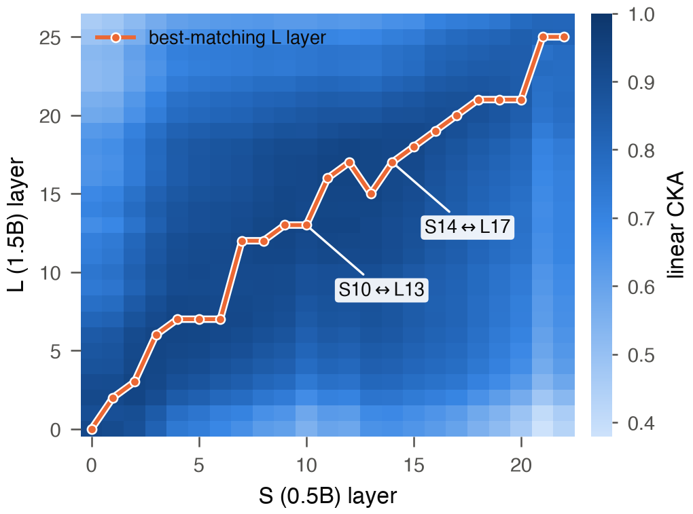
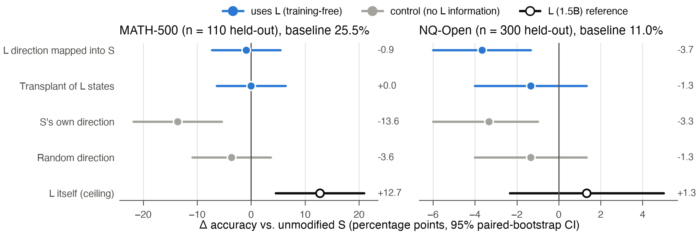
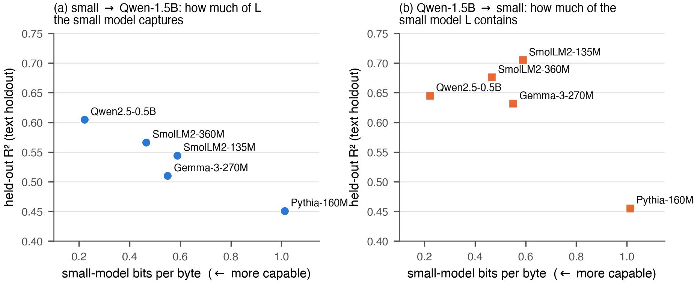
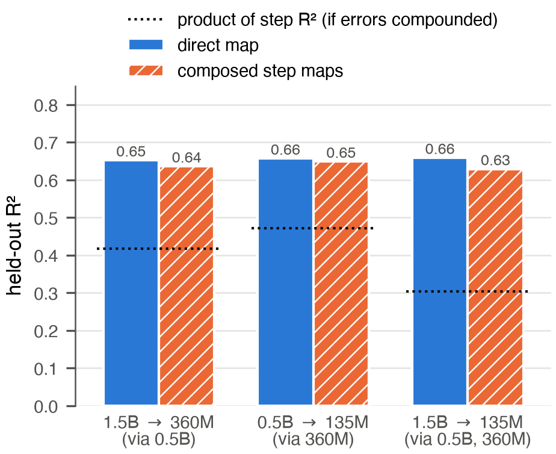
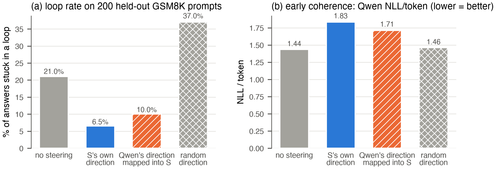

# Experiments: Can a training-free map from a larger model's representations improve a smaller model?

*Experiment 1: Qwen2.5-0.5B-Instruct (S) ↔ Qwen2.5-1.5B-Instruct (L). Run 2026-11-02 to 11-07 on an Apple M3 Max (36 GB), commit `d107e0c`. Code: `scripts/exp1_qwen_0.5b_1.5b/` (stand-alone; the reusable `weightmap` package was extracted from it afterwards).*

---

## 1. Motivation

*Sparks of Weight-Space Programming* (Takehi, Teoh, Zhang, Khattab; MIT CSAIL, Nov 2026) shows a frontier LLM ("Astra") reading and editing the weights of small networks directly, with no gradient descent. Its headline LLM result: an edit to 0.016% of Qwen3.5-0.8B's weights removed a looping failure, taking MATH-500 accuracy from 7.9% to 48.1%. The authors conclude that editing "could remove an obstacle that hid an ability, but it could not add an ability the model lacked."

That result prompted the following hypothesis.

## 2. Hypotheses

| ID | Claim |
|---|---|
| **H1** | Models of different sizes occupy related *sets* (regions) of a shared space. They aren't identical points, but they are structurally related. |
| **H2** | There is a map **F** between the small model's space (S) and the large model's space (L). |
| **H3** | S is effectively *contained* in L: L's representation subsumes S's. |
| **H4** | F carries capability-relevant information *from L*, so F can be used to steer or edit S toward problems that only L solves, **without training**. |
| **H5** | Applied recursively (tiny → small → large), the same construction should compose. *(Not tested yet.)* |

**Operationalization.** Raw weight spaces of different-width models aren't directly comparable: different dimensions, plus permutation and rotation symmetries. So every test here works in *representation space*, the residual-stream activations at matched tokens. The two models share a tokenizer, which makes token-level pairing exact.

**Problem-set framing.** Let P_L be the problems L solves and P_S the problems S solves. The target set is P_L \ P_S. It splits into:
- **blocked:** S has the ability but fails to use it reliably. Operationally, S solves the problem in at least 1 of 8 samples.
- **absent:** S never solves it in 8 samples.

H4 predicts that L-derived edits convert target problems into successes. The blog's conclusion predicts that any gains are confined to *blocked* problems.

**Constraint.** No model is trained or fine-tuned. Every step uses forward passes, sampling, or closed-form linear algebra. The only fitted object is a ridge-regression map solved in closed form.

---

## 3. Setup

| | |
|---|---|
| S (small) | `Qwen/Qwen2.5-0.5B-Instruct`: 24 layers, d = 896 |
| L (large) | `Qwen/Qwen2.5-1.5B-Instruct`: 28 layers, d = 1536 |
| Tokenizer | Identical (vocabularies verified equal) |
| Precision / device | bf16 on MPS |
| Reasoning task | MATH. Directions come from `EleutherAI/hendrycks_math` train (120 sampled); evaluation is on `HuggingFaceH4/MATH-500` (150 sampled; no overlap with train) |
| Knowledge task | NQ-Open (`google-research-datasets/nq_open`): 400 train, 400 validation (sampled, seed 0) |
| MATH prompt | System: "Please reason step by step, and put your final answer within \boxed{}." Max 512 new tokens |
| NQ prompt | System: "Answer the question with a short factual answer (a few words). Do not explain." Max 24 new tokens |
| MATH grading | Last `\boxed{}` compared with `math-verify` |
| NQ grading | SQuAD-style normalization; correct if any gold alias is a substring of the first output line |
| Decoding | Greedy for evaluation; temperature 0.8 / top-p 0.95 for the blocked/absent sampling |

The sizes were deliberately small, chosen so the whole pipeline runs in about 15 minutes on a laptop. See §7 for what that costs in statistical power.

---

## 4. Pipeline

| Stage | Script | What it does |
|---|---|---|
| 1 | `scripts/exp1_qwen_0.5b_1.5b/s1_generate.py` | Greedy outputs of S and L on all four splits, partitioned into both / L-only (target) / S-only / neither |
| 2 | `s2_latent.py` | For test-split target problems, sample S k = 8 times: blocked (≥1 correct) vs absent (0 correct) |
| 3 | `s3_map.py` | (a) Linear CKA between every S layer and every L layer. (b) Closed-form ridge maps L→S and S→L at S layers {10, 14} paired with their best-CKA L layer, plus controls. (c) Correct-vs-wrong contrast directions |
| 4 | `s4_steer.py` | Training-free edits of S, tuned on a slice of the test split and evaluated on the disjoint remainder |
| 5 | `s5_fold.py` | Folds the best static edit into S's weights and verifies equivalence |
| – | `make_figures.py` | Paper figures (PDF + PNG) in `docs/figures/` |

### 4.1 Representation map (stage 3)

- **Data:** L's own outputs on the train splits (520 texts in chat format), run through both models. Both models see identical token positions; 40 positions per text are sampled.
- **Filtering:** attention-sink / massive-activation tokens are dropped (norm > 5× median at the middle layer in either model), and 15,000 tokens are kept.
- **CKA:** linear CKA on 5,000 tokens, for all 23 × 27 layer pairs (final normed layers excluded).
- **Ridge maps:** fitted in both directions; λ ∈ {1e-4 … 1e-1} × mean feature variance, chosen on an 80/20 token split. The report gives held-out R² (variance-weighted).
- **Controls:**
  - *Shuffled:* the token pairing is broken by permuting rows. This tests whether the map relies on token-level correspondence.
  - *Reference:* predicting S's layer ℓ from S's own layer ℓ−1. This is a ceiling for "highly related."

**Contrast directions.** Use the train-split target problems: 21 for MATH and 25 for NQ. Each has a positive text (prompt + L's correct answer) and a negative text (prompt + S's wrong answer). Representations are averaged over completion tokens, then over problems.
- `d_S = mean_S(pos) − mean_S(neg)`, encoded by S.
- `d_L→S = Map_{L→S}(mean_L(pos) − mean_L(neg))`, encoded by L and mapped with the linear part of the ridge map.

The texts are identical for both; only the encoder differs. So any advantage of `d_L→S` over `d_S` has to come from information in L's representation.

### 4.2 Edits (stage 4)

Every edit is applied to S at a single decoder-layer output (the residual stream).

| Condition | Edit |
|---|---|
| base | none |
| S-native | add `c · ‖d_S‖ · unit(d_S)` at every position |
| L→S | add `c · ‖d_S‖ · unit(d_L→S)`, the same norm as S-native |
| random | add `c · ‖d_S‖ · unit(N(0, I))`, at the same layer and scale as the best L→S setting |
| transplant | per problem, run L on the prompt and map its layer states into S: `h ← (1−β)·h + β·Map(h_L)` at prompt positions during prefill, sink tokens excluded. L is needed at inference time, so this isn't a static edit |
| L (ceiling) | L's own greedy answers |

- **Grid:** layer ∈ {10, 14}; c ∈ {1, 2, 4}; β ∈ {0.5, 1.0}.
- **Tuning:** a random slice of the test split (MATH 40 problems, NQ 100), selecting by accuracy on that slice. The report uses the disjoint remainder (MATH 110, NQ 300).
- **Statistics:** 95% CIs come from a paired bootstrap (5,000 resamples) of per-problem differences against base.

---

## 5. Results

### 5.1 Stage 1: accuracy and partition

| Split | n | S acc | L acc | Both | **L only (target)** | S only | Neither |
|---|---|---|---|---|---|---|---|
| MATH train | 120 | 29.2% | 40.8% | 28 | **21** | 7 | 64 |
| MATH-500 test | 150 | 20.7% | 38.7% | 26 | **32** | 5 | 87 |
| NQ train | 400 | 5.2% | 10.0% | 15 | **25** | 6 | 354 |
| NQ test | 400 | 10.0% | 12.0% | 25 | **23** | 15 | 337 |

Absolute MATH numbers are below published figures because of the 512-token cap: long solutions get truncated. The cap is the same for every condition, so comparisons between conditions are unaffected.

### 5.2 Stage 2: blocked vs absent (H-precondition)


| Task | Target | Blocked (pass@8 > 0) | Absent | % blocked |
|---|---|---|---|---|
| MATH-500 | 32 | 20 | 12 | **62.5%** |
| NQ-Open | 23 | 13 | 10 | 56.5% |

Most of the S/L gap on MATH is *latent* in S. The NQ figure is an upper bound: short answers (years, common names) can be hit by chance across 8 samples.

### 5.3 Stage 3: is there a map? (H1, H2, H3)



**CKA.** The best-matching L layer for each S layer rises almost monotonically:

`{0:0, 1:2, 2:3, 3:6, 4:7, 5:7, 6:7, 7:12, 8:12, 9:13, 10:13, 11:16, 12:17, 13:15, 14:17, 15:18, 16:19, 17:20, 18:21, 19:21, 20:21, 21:25, 22:25}`

The peak CKA per S layer is 0.92–0.94 for layers 0–15, falling to 0.81 at layer 22. So representations agree most in early and middle layers and diverge toward the output.


| S layer ↔ L layer | CKA | R² L→S | R² S→L | R² L→S shuffled | R² S(ℓ−1)→S(ℓ) |
|---|---|---|---|---|---|
| 10 ↔ 13 | 0.927 | **0.851** | 0.820 | −0.113 | 0.966 |
| 14 ↔ 17 | 0.921 | **0.852** | 0.834 | −0.108 | 0.941 |

**Direction agreement**, `cos(d_S, Map(d_L))`:

| Task | Layer 10 | Layer 14 |
|---|---|---|
| MATH | 0.847 | 0.846 |
| NQ | 0.752 | 0.734 |

Norms for context: at layer 10, ‖d_S‖ = 0.55 on MATH and 1.84 on NQ, against a median residual-stream norm of about 15.1.

**Reading.**
- **H2, a map exists: supported.** A single linear map explains 85% of S's state variance from L's state at the same token. Breaking the token pairing drives R² negative. **Correction (§5.6):** the 0.85 is inflated by chat-template tokens. On answer text with whole texts held out, it is **0.66–0.67**.
- **H1, related sets: supported** in representation space. Layer order is preserved, and the map approaches the S-to-itself reference.
- **H3, S contained in L: weak.** L→S beats S→L by only 0.02–0.03 R². Predicting a wider target is somewhat harder anyway, so this asymmetry is not strong evidence.
- Stage 4 adds evidence for H2: replacing S's layer-14 prompt states entirely (β = 1) with *mapped L states* leaves S solving MATH at its normal rate (22.5% vs a 30% tune baseline; see 5.4). So the translated representation is usable by S's downstream layers.

### 5.4 Stage 4: does the map transfer capability? (H4)

**Tuning slice** (MATH n = 40, NQ n = 100). The MATH tune baseline was generated at batch size 64; all other runs used 32. See §7.

| Config | MATH | NQ |
|---|---|---|
| base | 0.300 | 0.070 |
| S-native L10 ×1 / ×2 / ×4 | 0.200 / 0.200 / 0.225 | 0.08 / 0.06 / 0.02 |
| S-native L14 ×1 / ×2 / ×4 | 0.225 / 0.200 / 0.200 | 0.06 / 0.04 / 0.01 |
| L→S L10 ×1 / ×2 / ×4 | 0.175 / **0.325** / 0.225 | **0.08** / 0.07 / 0.02 |
| L→S L14 ×1 / ×2 / ×4 | 0.275 / 0.225 / 0.225 | 0.07 / 0.04 / 0.02 |
| transplant L10 β .5 / 1 | 0.200 / 0.225 | **0.09** / 0.06 |
| transplant L14 β .5 / 1 | **0.250** / 0.225 | 0.08 / 0.07 |

**Selected configurations.**
- MATH: S-native (L10, ×4), L→S (L10, ×2), transplant (L14, β = 0.5), random (L10, ×2).
- NQ: S-native (L10, ×1), L→S (L10, ×1), transplant (L10, β = 0.5), random (L10, ×1).

An earlier grid scaled edits to 25–50% of the residual norm, roughly 7–14× the natural ‖d_S‖. It collapsed MATH accuracy to 2.5–5% and was discarded (§7).



**Held-out test, all problems.**

| Condition | MATH acc (n = 110) | Δ [95% CI] | NQ acc (n = 300) | Δ [95% CI] |
|---|---|---|---|---|
| base | 25.5% | – | 11.0% | – |
| **L→S direction** | 24.5% | −0.9 [−7.3, +5.5] | 7.3% | −3.7 [−6.0, −1.3] |
| **transplant** | 25.5% | +0.0 [−6.4, +6.4] | 9.7% | −1.3 [−4.0, +1.3] |
| S-native direction | 11.8% | −13.6 [−21.8, −5.5] | 7.7% | −3.3 [−6.0, −1.0] |
| random direction | 21.8% | −3.6 [−10.9, +3.6] | 9.7% | −1.3 [−4.0, +1.3] |
| L itself (ceiling) | 38.2% | +12.7 [+4.5, +20.9] | 12.3% | +1.3 [−2.3, +5.0] |


**Held-out subgroups.** Groups are defined from stage 1/2 labels.

| Task | Group | n | base | L→S | transplant | S-native | random | L |
|---|---|---|---|---|---|---|---|---|
| MATH | blocked | 13 | 30.8% | 30.8% | 23.1% | 15.4% | 23.1% | 100% |
| MATH | absent | 9 | 0% | 0% | 0% | 0% | 0% | 100% |
| MATH | S already correct | 23 | 91.3% | 87.0% | 87.0% | 43.5% | 69.6% | 87.0% |
| NQ | blocked | 9 | 0% | 11.1% | 33.3% | 11.1% | 11.1% | 100% |
| NQ | absent | 8 | 0% | 0% | 12.5% | 0% | 12.5% | 100% |
| NQ | S already correct | 34 | 97.1% | 61.8% | 67.6% | 61.8% | 67.6% | 58.8% |

**Reading.**
- **H4, L-derived edits improve S: not supported.** On MATH, the L→S direction and the transplant are *harmless* (Δ ≈ 0) but never beneficial. On NQ the L→S direction is mildly harmful.
- **The L-derived edit is safer than S's own direction.** On MATH, at the selected strengths, L→S keeps 87% of S's already-correct problems against 43.5% for S-native. But the two directions have cosine 0.85 and were selected at different strengths (×2 vs ×4), so this mostly reflects strength, not a qualitative difference.
- **Absent problems: none fixed on MATH** by any method (0/9). On NQ, transplant and random each fix 1/8, which is chance-level for short answers.
- **The NQ blocked-group gain for transplant (3/9) is not evidence.** n is 9, random also scores 1/9, and NQ "blocked" is chance-inflated (§5.2).

### 5.5 Stage 5: the edit as a weight edit

The best static L→S vector folds exactly into S as a bias on layer 10's `mlp.down_proj`. That changes 896 parameters, 0.00018% of S.

| Check | Max abs logit difference vs. hook |
|---|---|
| bf16 | 0.81 (MATH), 0.58 (NQ): rounding from a different summation order |
| **fp32** | **1.4 × 10⁻⁴**, with logit scale ≈ 32 |

The folded checkpoints are written to `scripts/exp1_qwen_0.5b_1.5b/results/S_edited_{math,nq}/`. They are git-ignored at 953 MB each, and since they improve nothing, they can be deleted.

### 5.6 Measurement check: text-level holdout, template tokens, layer pairing

*Added 2026-11-07, after extracting the `weightmap` library. Script: `scripts/validate_measurement.py`; raw output: `scripts/validate_measurement_results.json`.*

Refitting with the library on answer texts gave R² ≈ 0.69, not 0.85, so the stage-3 measurement was re-examined.

**Q1. Why 0.85?** The Qwen pair at layers 10/14 with CKA pairing, as in stage 3: a 2×2 of text type × holdout unit.

| Fit/score text | Token holdout | **Text holdout** |
|---|---|---|
| Answers only (520 texts) | 0.693 / 0.707 | **0.664 / 0.673** |
| Chat-formatted prompt + answer (as in stage 3) | 0.848 / 0.851 | 0.829 / 0.828 |

*(R² L→S at S10↔L13 / S14↔L17. S→L: 0.62–0.63 on answers with text holdout, 0.80–0.81 on chat with text holdout. Shuffled control: −0.15 on answers, −0.05 on chat. Self-reference S(ℓ−1)→S(ℓ): 0.86–0.91 on answers, 0.93–0.96 on chat.)*

- The chat-formatted + token-holdout cell **reproduces stage 3 exactly** (0.848 vs 0.851).
- **Holdout unit barely matters** (−0.02 to −0.03). Token-level leakage was not the main issue.
- **Boilerplate matters most** (−0.17). Every chat-formatted text, held-out ones included, contains the same system prompt and template tokens. Both models encode those near-identically, so they are easy points that lift the average.
- The meaningful figure for "how much of S is recoverable from L on *content*" is therefore **≈ 0.66**, not 0.85.
- **Unchanged:** the layer correspondence, the negative shuffled control, the L→S > S→L direction, and every stage-4 conclusion (stage 4 never used the R² value).

**Q2. Does pairing by predictability beat CKA across families?** SmolLM2-360M ← Qwen2.5-1.5B (different tokenizers), text holdout.

| SmolLM2 layer | CKA pairing → L layer, R² L→S | R²-pairing → L layer, R² L→S |
|---|---|---|
| 10 | L2 (CKA 0.41), 0.663 | L5, 0.655 |
| 15 | L6, 0.680 | L6, 0.680 |
| 20 | L17, 0.672 | L12, 0.670 |

The two rules pick different layers, but the map quality is the same. Several neighbouring large layers predict a small layer about equally well. CKA pairing stays the library default; `pair_by="r2"` is available.

**Cross-family result (H1).** A different family (SmolLM2, its own tokenizer and training data) maps to Qwen-1.5B as well as Qwen-0.5B does (0.66–0.68 vs 0.66–0.67), with a larger L→S vs S→L asymmetry (0.07–0.12 vs 0.04).

### 5.7 Quick follow-ups: weight-level map, linear vs non-linear, pruning-like structure

*Added 2026-11-08. Script: `scripts/quick_tests.py`; raw output: `scripts/quick_tests_results.json`, `scripts/quick_tests.log`. Everything is closed-form ridge; T2/T3 use answer texts with text-level holdout (12k train / 3k test tokens). The absolute R² here (0.64–0.65) is slightly below §5.6 (0.66–0.67) because of a different random token subsample and per-dimension standardization of L's states.*

**T1. Is there a map between the *weights* themselves?** Ridge from L's word-embedding table to S's, row by row (one row per token; 80/20 split over tokens). All three models tie input and output embeddings.

| Pair | Rows | R² L→S | R² S→L | Shuffled |
|---|---|---|---|---|
| Qwen2.5-1.5B → Qwen2.5-0.5B (same vocab) | 40,000 tokens | **0.31** | 0.21 | −0.04 |
| Qwen2.5-1.5B → SmolLM2-360M (shared token strings) | 39,237 strings | **0.42** | 0.30 | −0.04 |

A linear weight-space map exists, but it is about **half as strong as in hidden states** (0.31 vs 0.64). The models' representations agree more after computation than in their raw input tables. The L→S > S→L asymmetry appears here too. The cross-family number is higher, probably because the shared-string subset is mostly common, well-trained tokens, while Qwen's full vocabulary includes many rare tokens (an unverified explanation).

**T2. Linear or non-linear?** Linear ridge vs linear + 4,096 random Fourier features (a closed-form approximation to a Gaussian-kernel map; the bandwidth sweep is 0.5/1/2× the median distance).

| Pair | Linear | Linear + RFF (best) | Gain |
|---|---|---|---|
| S10 ← L13 | 0.638 | 0.605 | −0.033 |
| S14 ← L17 | 0.650 | 0.620 | −0.030 |

**Non-linear features add nothing** (slightly worse: the extra features overfit at this data size). At this scale f is effectively linear, so the missing ~35% is not "curved" structure that a richer map could recover. This removes "the linear transport was the bottleneck" as an explanation for the H4 null result. *Caveat:* with far more tokens, a non-linear map could still edge ahead.

**T3. Is S like a *pruned* L?** Predict S from a subset of L's coordinates. *Axis selection* keeps k of L's 1,536 residual dimensions, chosen by their weight in the full map (training data only), which is pruning-like. Compare this with L's top-k principal components (an unsupervised rotated subspace), k random dimensions, and all dimensions. The full linear map is already rank ≤ 896 (S's width), so "all 1536" is also the best possible rank-896 linear map.

| k (of 1536) | Axis selection | PCA top-k (rotated) | Random axes | All 1536 |
|---|---|---|---|---|
| 896 | **0.641 / 0.650** | 0.626 / 0.641 | 0.577 / 0.588 | 0.638 / 0.650 |
| 448 | **0.620 / 0.625** | 0.584 / 0.607 | – | |
| 224 | **0.557 / 0.563** | 0.530 / 0.560 | – | |

*(S10←L13 / S14←L17.)*

- **Selecting 896 of L's own coordinates matches the best linear map** (0.641 vs 0.638). No rotation is needed: S is recoverable from a *subset of L's neurons*, which is the pruning picture.
- **Which coordinates matters:** a random 896 loses ~0.06.
- **Half of L's dimensions (448) keep ~96%** of the map quality.
- *Caveat:* the PCA comparison is unsupervised, so it is a weaker baseline than selection, which uses the target. The clean statement is "axis selection reaches the optimum," not "axes beat rotations."

**Takeaways.**
1. f(L)→S is **linear**: non-linear features don't help.
2. f is **pruning-like**: S ≈ a linear readout of a *subset* of L's coordinates.
3. The weight-level f (embeddings) **exists but is weaker** than the representation-level f.

All three support the picture "S ≈ a compressed, partly pruned view of L," and none reopens H4.

### 5.8 Model atlas and recursion

*Added 2026-11-08. Script: `scripts/atlas_recursion.py`; raw output: `scripts/atlas_recursion_results.json`, `scripts/atlas_recursion.log`; figures: `scripts/fig_atlas_recursion.py`. No training: forward passes and closed-form ridge only. Text-level holdout; fit texts are Qwen-1.5B's own answers from experiment 1 (520 texts).*

**Atlas (H1, convergence).** Five small models from four families, each mapped onto Qwen2.5-1.5B (L) with `WeightMap` at 40% and 60% depth, CKA pairing. Capability is measured as bits per byte on the same texts, which is tokenizer-agnostic.



| Small model | Family | Params | Bits/byte ↓ | R² small→L | R² L→small |
|---|---|---|---|---|---|
| Qwen2.5-0.5B-Instruct | Qwen | 494M | **0.222** | **0.605** | 0.645 |
| SmolLM2-360M | SmolLM | 362M | 0.466 | 0.567 | 0.676 |
| Gemma-3-270M | Gemma | 268M | 0.551 | 0.510 | 0.632 |
| SmolLM2-135M | SmolLM | 135M | 0.588 | 0.544 | **0.705** |
| Pythia-160M | Pythia | 162M | 1.012 | 0.451 | 0.455 |
| *(Qwen2.5-1.5B itself)* | | 1.5B | 0.171 | | |

- **small→L tracks capability** (Spearman ρ = 0.9 against bits/byte). The more capable the small model, the more of the large model's representation it captures. This is the convergence signal (cf. the Platonic Representation Hypothesis) and supports H1.
- **L→small does not.** It is highest for SmolLM2-135M. Weaker models appear to have simpler representations that L easily contains, so L→small measures *containment*, not convergence. Pythia (oldest recipe, weakest) is low in both directions.
- The small→L vs L→small gap grows as models get weaker (0.04 for Qwen-0.5B, 0.16 for SmolLM2-135M). Small models look increasingly like *compressed* views of L.
- *Caveat:* the texts were generated by Qwen-1.5B, which favours Qwen models on bits/byte (Qwen-0.5B 0.22 vs SmolLM2-360M 0.47) and possibly on map quality. n = 5 models.

**Recursion (H5, composition).** Chain Qwen-1.5B → Qwen-0.5B → SmolLM2-360M → SmolLM2-135M, at layer ≈ 45% depth (12, 10, 14, 13), on tokens aligned across both tokenizers. Fit each step map, compose them, and compare with a direct map; λ is chosen on an inner text-level split of the training texts only.



| Step maps | R² |
|---|---|
| 1.5B → 0.5B | 0.645 |
| 0.5B → 360M | 0.647 |
| 360M → 135M | 0.730 |

| End-to-end | Direct map | Composed via chain | Composed / direct | Product of step R² |
|---|---|---|---|---|
| 1.5B → 360M (via 0.5B) | 0.653 | 0.637 | **0.975** | 0.42 |
| 0.5B → 135M (via 360M) | 0.657 | 0.649 | **0.988** | 0.47 |
| 1.5B → 135M (via 0.5B, 360M) | 0.659 | 0.629 | **0.955** | 0.30 |

- **Maps compose almost losslessly:** chaining three maps keeps 95.5% of the direct map's quality, including across the Qwen→SmolLM family boundary.
- **Errors don't compound.** If they did, composed R² would be near the product of the step R² values (0.30 for the full chain), but it is 0.63. Each step mostly discards information the next, smaller model doesn't represent anyway. This is consistent with the "compressed / pruned view" picture of §5.7.
- **H5 is supported in the compression direction** (large → small → smaller). The expansion direction (small → large adding ability) remains unsupported (§5.4).
- *Caveat:* there are only 3.3k training / 0.9k test tokens, because NQ answers are short and few positions align across all four models. It is one layer per model, chosen by relative depth.

### 5.9 Can the large model's view diagnose a small model's failure? (loop removal)

*Added 2026-11-11. Scripts: `scripts/loop_diagnostic.py` (main run with tuning; `FIXED=18:2` for the held-out comparison); raw output: `scripts/loop_diagnostic_results.json`, `scripts/loop_diagnostic_fixed_18x2.json`, logs; figure: `scripts/fig_loop_diagnostic.py`. No training: steering only.*

**Motivation.** Barry (2026, "Can a Linear Program Do Weight-Space Programming?") showed that the blog's Qwen3.5-0.8B fix was a single "looping minus productive" direction: a rank-1 edit or even a constant steering vector moved MATH-500 from 7% to 51%. Our Qwen2.5-0.5B never loops (0% by the same detector; its MATH failures are 512-token truncations, §7), so there was nothing to remove. SmolLM2-135M (base) does loop. It is the test bed here, with Qwen2.5-1.5B (which never loops) as the "healthy" large model, connected by a cross-tokenizer map.

**Method.**
1. S answers 400 GSM8K *train* prompts (greedy, 256 tokens). A repetition detector (16-token windows; loop = suffix with ≥80% repeats, ≥64 tokens) labels 95 outputs looping and 305 productive.
2. **Loop direction** = mean state over loop regions − mean state over productive completions, built from the *same texts* two ways: **S-native** (S encodes them) and **L→S** (Qwen-1.5B encodes them, transported through the map; layer pairing S12↔L6, S18↔L10; held-out R² 0.84 / 0.77, inflated by repeated prompt and loop tokens; shuffled control −0.07 / −0.06). A **random** direction of the same norm is the control.
3. Steer S *against* the direction. The grid is layer ∈ {12, 18} × strength ∈ {1, 2, 4}·‖d_S‖ on 60 tune prompts; evaluation is on 200 held-out GSM8K *test* prompts.

**Directions agree almost perfectly:** cos(d_S, Map(d_L)) = **0.984** (layer 12) and **0.985** (layer 18), against 0.85 for the correct-vs-wrong direction in §5.3.

**Tune grid (loop rate / early coherence; base 23.3% / 1.36).** Only layer 18 at 2× removes loops: S-native 1.7% / 1.81, L→S 8.3% / 1.74. At 1× there is no effect, and 4× degenerates (53–55% / 3.20). The main run's selection rule (coherence within +15% of base) excluded the 2× setting and picked 1×, which did nothing on test (S-native 24%, L→S 24%, random 39.5%, base 21%). The comparison below fixes layer 18, 2× for every method. That setting comes from the tune grid, not the test set.



| Held-out (200 GSM8K test prompts), layer 18, 2× | Loop rate | Accuracy | Early coherence (Qwen NLL/tok, first 48 tokens) |
|---|---|---|---|
| No steering | 21.0% | 2.0% | 1.44 |
| **S's own loop direction** | **6.5%** | 1.5% | 1.83 |
| **Qwen's loop direction, mapped into S** | **10.0%** | 2.5% | 1.71 |
| Random direction, same norm | 37.0% | 2.0% | 1.46 |

**Reading.**
- **The diagnosis transfers.** A loop direction located through the *large* model's representation (Qwen never loops; it only re-encodes S's outputs), translated through the map, removes about half of S's loops (21% → 10%). A random direction of the same size *increases* loops (37%). So the map carries the failure direction, not just generic disruption.
- **It is not better than S's own.** S-native removes more loops (6.5%); L→S costs slightly less coherence (1.71 vs 1.83). With cos 0.985 these are essentially the same direction at slightly different effective strength. The difference (13 vs 20 looping answers of 200) is within noise. So the large model's view *works* for diagnosis but adds nothing S couldn't find itself.
- **Removing the blocker adds no ability:** accuracy stays at 1.5–2.5%. SmolLM2-135M can't solve GSM8K whether or not it loops. This replicates the blog's Gemma-270M null and the "unlock, don't add" conclusion.
- *Caveats:* loop direction and test use the same prompt template; one strength/layer comparison; coherence is a proxy (full-text NLL would reward loops, so only the first 48 tokens are scored); n = 200.

---

### 5.10 Token-identity control: how much of R² is "same token"?

`scripts/controls_baselines.py`. Predict S's mid layers from: trained L (best layer, chosen on an inner split), L's input embedding only, an untrained copy of L, and S's own embedding. Same texts, aligned tokens, text holdout.

| S, layer | trained L (best) | L embedding only | untrained L | S's own embedding |
|---|---|---|---|---|
| Qwen-0.5B, 9 | 0.651 (L layer 10) | 0.419 | 0.344 | 0.402 |
| Qwen-0.5B, 14 | 0.641 (L19) | 0.346 | 0.278 | 0.334 |
| SmolLM2-135M, 12 | 0.727 (L4) | 0.594 | 0.488 | 0.582 |
| SmolLM2-135M, 17 | 0.664 (L8) | 0.489 | 0.401 | 0.468 |

**Reading.** Half to three quarters of the map's R² is token identity. The context-dependent shared part is about +0.13 to +0.30. For SmolLM2 the best L layers are shallow (4–8 of 28). H1 holds only weakly.

### 5.11 Error bars for the loop result

`scripts/loop_stats.py` (no compute). Wilson 95% intervals, two-proportion tests, n = 200: base 21% [16, 27]; S-own 6.5% [4, 11]; L→S 10% [7, 15]; random 37% [31, 44]. Base vs L→S p = 0.002; S-own vs L→S p = 0.20 (indistinguishable); accuracy unchanged for all (p > 0.4).

### 5.12 Block transplant: is F a map between weights?

`scripts/block_transplant.py`. Replace block s of Qwen-0.5B with Qwen-1.5B's block at matched depth, conjugated by ridge maps (S_in → L_in, L block, L_out → S_out). Held-out next-token loss, as a share of the damage from deleting the block (100% = S's own block). Position 0 keeps S's output in all conditions.

| replacement | block 6 | block 12 | block 18 |
|---|---|---|---|
| linear stand-in for S's own block | 61% | 52% | 42% |
| L block, natural maps only (strict) | −10% | −283% | −341% |
| L block, output map refit through it | 43% | 30% | −17% |
| random block, output map refit | 39% | 11% | −6% |

**Reading.** The strict transplant is worse than deletion. Refitting helps about as much for a random block, and S's own linear stand-in beats every version. F relates representations, not computations.

### 5.13 Porting a sparse LP weight edit (Barry-style)

`scripts/lp_port.py` (`SWEEP=1`). Edit dW = δ·u vᵀ on SmolLM2-135M block 18 down_proj, 8 columns. v from Barry's LP (min ‖v‖₁ + slack, v·h ≤ −1 on loop tokens, |v·h| ≤ ε on productive tokens). Ported edit: u = Map(d_L); v = L's own 8-column LP trigger carried to S neurons by a label-free matching LP. Strength picked on a 60-problem tune slice (4× ‖d_S‖), test n = 200.

| edit | loop rate | trigger AUC (held-out tokens) |
|---|---|---|
| none | 21.0% | – |
| S's own LP edit | 8.5% (p ≈ 0.0004) | 0.72 |
| hybrid: S trigger + L direction | 14.0% (p ≈ 0.07) | 0.72 |
| fully ported | 28.0% | 0.61 (L's trigger inside L: 0.77) |
| random 8 columns | 60.5% | 0.57 |

S's 8 neurons reproduce L's trigger with R² = 0.05. **Reading.** The payload direction ports partly (the hybrid gets about half of S's own effect). The neuron-level trigger does not port. An untuned first run at 2× is in `lp_port_single.log` / `lp_port_results.json`.

### 5.14 Who solves what: tiny, small, large (behavioural containment)

`scripts/tiny_venn.py`. Greedy answers on the exp1 held-out problems (same prompts and token budgets as stage 1), adding tiny = SmolLM2-135M-Instruct. The base SmolLM2-135M has no chat template, so the Instruct version is used. Tiny never writes `\boxed{}`, so MATH is re-graded for all three models with a lenient grader (the boxed answer, or else the last number). Strict grading gives tiny 0, small 31 and large 58.

| region (problems) | MATH, lenient (n = 150) | NQ (n = 400) |
|---|---|---|
| solved by tiny / small / large | 5 / 34 / 63 | 34 / 40 / 48 |
| all three | 4 | 13 |
| small + large only | 24 | 12 |
| tiny + small only / tiny + large only | 0 / 0 | 6 / 5 |
| tiny only / small only / large only | 1 / 6 / 35 | 10 / 9 / 18 |
| none | 80 | 327 |

**Reading.** For reasoning (MATH) the solved sets nest: tiny ⊂ small ⊂ large, with only a handful of exceptions. For facts (NQ) they don't: each model knows facts the others miss (tiny alone gets 10). Behavioural containment (H3) holds for reasoning, not for memorised facts.

### 5.15 Rotation + scale versus ridge

`scripts/rotation_vs_ridge.py`. Same data, split and layer choice as §5.10. Rotation = orthogonal Procrustes (semi-orthogonal across widths) with one least-squares scale. Held-out R² predicting the small model's layer from Qwen-1.5B, ridge / rotation:

| small model, layer | trained L | L embedding only | untrained L | shared part (trained − embedding) |
|---|---|---|---|---|
| Qwen-0.5B, 9 | 0.651 / 0.554 | 0.419 / 0.253 | 0.344 / 0.164 | 0.232 / 0.301 |
| Qwen-0.5B, 14 | 0.641 / 0.557 | 0.346 / 0.190 | 0.278 / 0.114 | 0.294 / 0.367 |
| SmolLM2-135M, 12 | 0.727 / 0.562 | 0.594 / 0.386 | 0.488 / 0.236 | 0.132 / 0.176 |
| SmolLM2-135M, 17 | 0.664 / 0.527 | 0.489 / 0.303 | 0.401 / 0.184 | 0.176 / 0.224 |

**Reading.** The rotation fits less overall but credits token identity less, so its shared part is slightly larger. Token identity is still 34–69% of what the rotation explains.

### 5.16 Fact swap with token-identity controls

`scripts/fact_swap.py`. The swap test of the concurrent work "Plato's Key" (Cheng et al., Hazy Research, 2026-11-25) on this project's models. CounterFact, 6,555 prompts from 34 relations; a model knows a fact if its greedy next token is the first answer token (Qwen-1.5B 986, SmolLM2-360M 718, Gemma-3-270M 611, Qwen-0.5B 597, SmolLM2-135M 409). The donor's state at the last subject token of fact A is mapped and written over the recipient's state at the last subject token of fact B (same relation, different answer); success = the recipient outputs A's answer. Subjects split 60/15/25; layer pairs at equal relative depth, chosen per method on validation facts.

| donor → recipient | test facts | own state | ridge | rotation | subject tokens only | last token only | random rotation | unrelated fact |
|---|---|---|---|---|---|---|---|---|
| Qwen-1.5B → Qwen-0.5B | 117 | 33.3% | 27.4% | 20.5% | 16.2% | 11.1% | 6.0% | 0.9% |
| Qwen-0.5B → SmolLM2-360M | 91 | 46.2% | 36.3% | 30.8% | 23.1% | 13.2% | 6.6% | 0.0% |
| SmolLM2-360M → SmolLM2-135M | 87 | 28.7% | 20.7% | 21.8% | 10.3% | 12.6% | 8.0% | 4.6% |
| Qwen-1.5B → SmolLM2-135M | 86 | 30.2% | 22.1% | 20.9% | 18.6% | 14.0% | 10.5% | 3.5% |
| Qwen-1.5B → Gemma-3-270M | 126 | 24.6% | 17.5% | 9.5% | 6.3% | 6.3% | 1.6% | 0.0% |
| Qwen-0.5B → Qwen-1.5B | 117 | 50.4% | 28.2% | 29.9% | 25.6% | 10.3% | 7.7% | 0.0% |

"Subject tokens only" is a ridge map from the mean of the donor's input embeddings of the subject's tokens. Composed chain Qwen-1.5B → 0.5B → 360M → 135M: ridge 11.6% (direct 22.1%), rotation 16.3% (direct 20.9%).

**Reading.** The ridge map transfers 56–82% as many facts as the recipient's own states. The subject-token control reaches 26–62% of that ceiling, so roughly half of the transfer needs nothing the donor computed. Composition loses more in behaviour than in R² (§5.8). *Caveats:* 86–126 test facts per pair; first-token match; Instruct models on raw completion prompts.

The full write-up of all experiments is the technical report at <https://nishparadox.com/research/weightmap/>.

### 5.17 Controls added after review: loop direction and trigger port

Three independent reviews of the write-up flagged that (a) in §5.9 the map was fitted on the same SmolLM2 outputs that define the looping and productive groups, so the mapped direction could match S's own by construction, and (b) in §5.13 the "no counterpart" claim for the trigger rested on an 8-neuron heuristic with no dense baseline. Both were tested.

**Loop direction** (`scripts/loop_controls.py`, results in `loop_controls_results.json`). Same models, layers (S block 18, L block 10), prompts and detector. Maps: original (fitted on S's 400 outputs, R² 0.77), independent (fitted on 175 unrelated texts, R² 0.65), embedding-only independent (L's input embeddings, R² 0.47).

| direction | cosine with S's own | random-split cosine, mean (range) | loop rate at 2× (n = 200) | early NLL |
|---|---|---|---|---|
| none | | | 21.0% | 1.44 |
| S's own | 1 | | 5.0% | 1.85 |
| L's, original map | 0.985 | 0.92 (0.86–0.97) | 11.0% | 1.70 |
| L's, independent map | 0.82 | 0.70 (0.51–0.85) | 18.5% | 1.57 |
| L's input embeddings, independent map | 0.64 | 0.49 (0.22–0.76) | 26.5% | 1.51 |
| random | | | 23.5% | 1.45 |

Dose response: S's own 23% / 5% / 19% / 58.5% at 1× / 2× / 3× / 4×; L's through the independent map 28% / 18.5% / 31.5% / 60.5%. Qwen-1.5B on the same 200 prompts: 0 looping outputs, 25% correct.

**Reading.** The 0.985 cosine and the 21% → 10% reduction of §5.9 were mostly produced by fitting the map on the looping texts: a random split of the same texts transfers at cosine 0.92. Through an independent map the direction is recognisable (0.82) but does not reduce loops at any strength. S's own direction works only at 2×, at a coherence cost above the +15% rule. *Caveat:* the unrelated texts are fewer and of a different kind, so the independent map is also a weaker map.

**Trigger port** (`DENSE=1`, `FOLLOWUP=1`, `FOLLOWUP=2` in `scripts/lp_port.py`; results in `lp_port_dense_results.json`, `lp_port_followup_results.json`, `lp_port_trigger_firing.json`). L's trigger fitted from S's neurons, held-out tokens (1,888 train / 472 test):

| fit | neurons | R² | AUC |
|---|---|---|---|
| port program, reduced | 8 | 0.05 | 0.61 |
| ridge, top-k of dense fit | 8 / 32 / 128 / 512 | 0.12 / 0.25 / 0.40 / 0.45 | 0.58 / 0.68 / 0.72 / 0.75 |
| ridge, all neurons | 1,536 | 0.46 | 0.76 |
| port program, no limit | 574 | 0.16 | 0.67 |

As rank-1 edits with S's own direction as payload (n = 200; base 21%): S's own 8-neuron trigger 15.5% (2×) / 8.5% (4×); ported 8-neuron trigger 21.5% / 28.0%; ported 574-neuron trigger **10.0%** (2×, early NLL 1.48) / 7.0% (4×, NLL 1.85); S's own unreduced trigger (450 neurons) 20.5% / 15.5%. Mean trigger on looping / productive tokens: S's own 8: −0.68 / −0.37; ported 574: −0.62 / −0.29; L in L: −0.79 / −0.24.

**Reading.** The trigger does transfer when dense and fails only under the 8-neuron limit. Combined with the loop-direction control this replaces the §6 interpretation: what transfers is distributed (states, facts, a dense detector); what does not is compact (one steering direction, an 8-neuron trigger) or structural (a block). *Caveat:* L's trigger was fitted with loop labels from S's outputs and the port is fitted on the same texts, so this shows the detector can be re-expressed in S's neurons, not that L supplies information S lacks.

Written but not yet run: `scripts/atlas_extend.py` (5 more atlas models, exact permutation p) and `scripts/recursion_seeds.py` (5-seed recursion).

## 6. Conclusion

| Hypothesis | Verdict | Key evidence |
|---|---|---|
| Precondition: much of P_L \ P_S is latent in S | **Supported** | 62.5% of MATH targets are blocked |
| H1: related sets | **Supported** (representation space) | Monotone CKA layer correspondence; CKA ≈ 0.92 |
| H2: a map F exists | **Supported** | R² **0.66–0.67** on held-out answer texts (0.85 originally, inflated by template tokens, §5.6) vs −0.15 shuffled; transplanted states remain usable by S; holds cross-family (SmolLM2 ← Qwen 0.66–0.68) |
| H3: S contained in L | **Weak to moderate** (representations); **yes for reasoning, no for facts** (behaviour) | L→S beats S→L by 0.04 (Qwen pair), 0.07–0.12 (SmolLM2 ← Qwen); MATH solved sets nest tiny ⊂ small ⊂ large (4 of tiny's 5 solved by all), NQ facts don't (tiny alone 10), §5.14 |
| H4: F transfers capability without training | **Not supported** (at this scale and method) | L→S Δ −0.9 [−7, +5] (MATH), −3.7 [−6, −1] (NQ); 0/9 absent fixed |
| f is linear | **Yes** (at this scale) | Random-Fourier-feature map adds nothing (−0.03), §5.7 |
| S looks like a pruned L | **Supported** | 896 selected L coordinates match the full map (0.641 vs 0.638); random 896: 0.577, §5.7 |
| Weight-level map (embedding tables) | **Weak** | R² 0.31 (Qwen→Qwen), 0.42 (Qwen→SmolLM2 shared tokens), §5.7 |
| H1 refined: convergence tracks capability | **Supported** | small→L R² rises with small-model capability across 5 models / 4 families (ρ = 0.9), §5.8 |
| Map as a diagnostic tool (failure directions transfer) | **Yes, but no advantage** | Qwen's loop direction mapped into SmolLM2-135M cuts loops 21% → 10% (random: 37%); S's own: 6.5%; cos 0.985; accuracy unchanged, §5.9 |
| H5: recursion | **Supported for compression** (L→S→T) | Composing 3 step maps keeps 95.5% of the direct map; errors don't compound (0.63 vs 0.30), §5.8. Expansion direction unsupported |
| Token-identity control | **Weakens H1** | L's embedding alone gives 0.35–0.59; shared context part ≈ +0.13–0.30, §5.10 |
| F as a weight-space map (block transplant) | **Not supported** | L's block through the maps is worse than deleting S's block; random block ≈ refit L block, §5.12 |
| Weight-space programs port (LP edit) | **Only when dense** | 8-neuron trigger: no (R² 0.05). 574-neuron trigger: loops 21% → 10%, §5.17. Supersedes the "half" reading of §5.13 |
| Steering direction transfers | **Not in behaviour** | Through an independent map: cosine 0.82, loops 18.5% vs 21%, §5.17. Supersedes §5.9 |

**Interpretation (revised after the controls of §5.17).** What transfers between these models is distributed (whole states, facts, a dense detector); what does not is compact (one steering direction, an 8-neuron trigger) or structural (a block). The earlier reading, "residual-stream directions port, neurons do not", did not survive the controls. F behaves like a faithful translation, not an upgrade. L's correct-vs-wrong direction, projected into S, is close to S's own (cos 0.85). Whatever in L's representation has no counterpart in S's coordinates is discarded by the projection, and that is plausibly the part that makes L better.

This agrees with the blog's "unlock, don't add" conclusion. It also suggests that Astra's edits came from reasoning plus experimentation (its forward-pass budget), not from an implicit cross-scale weight map.

---

## 7. Threats to validity and engineering notes

1. **Small n.** About 22 target problems per task and 110/300 held-out problems. The CIs exclude large effects (e.g. > +6 points on MATH for L→S), not small ones.
2. **Batch-order nondeterminism.** bf16 greedy decoding on MPS depends on batch composition and padding. The same S re-run scored 91–97% on problems it solved in stage 1, and 30.8% on MATH "blocked" problems it got wrong in stage 1. So differences under about 6 points are within noise. The MATH tune baseline (bs 64) also differed from the grid runs (bs 32). The held-out comparison uses matched batching throughout.
3. **Crude edit family.** Only a single mean-difference direction at one layer was tested. The blog's successful edit removed a *specific failure direction* (looping), found by inspection. That is a different and untested method.
4. **One model family, shared tokenizer.** This is the easiest case for a map. Cross-family (e.g. Qwen ↔ Llama) is the real test of "all models converge."
5. **512-token cap on MATH.** It truncates long solutions and lowers absolute accuracy.
6. **CKA is inflated by token identity.** For that reason the ridge map with a shuffled control, not CKA, is the primary evidence for H2.
7. **NQ has little headroom.** L barely beats S (12.0% vs 10.0%), so NQ is weak for testing H4.
8. **Template tokens inflated stage-3 R²** (0.85 → 0.66 on content). Corrected in §5.6. Fit and score maps on content text, not chat-templated prompts.

**Bugs fixed during the run** (recorded for reproducibility):
- `hidden_states()` originally ran the full model, materializing [B, T, 152k] logits. The process reached 33 GB and stalled in swap. It now calls `model.model(...)`.
- Setting `PYTORCH_MPS_HIGH_WATERMARK_RATIO=0.4` without a low ratio raised `invalid low watermark ratio 1.4`. The fix is to also set `PYTORCH_MPS_LOW_WATERMARK_RATIO=0.3`.
- The first steering grid used strengths relative to the residual norm, about 10× too large. It was rescaled to multiples of ‖d_S‖, with the same norm for every method.

---

## 8. Reproduce

```bash
uv sync --extra experiments
export PYTORCH_MPS_HIGH_WATERMARK_RATIO=0.4 PYTORCH_MPS_LOW_WATERMARK_RATIO=0.3
cd scripts/exp1_qwen_0.5b_1.5b
uv run python s1_generate.py    # ~6 min
uv run python s2_latent.py      # ~3 min
uv run python s3_map.py         # ~3 min
uv run python s4_steer.py       # ~14 min
uv run python s5_fold.py        # ~1 min
uv run python make_figures.py   # figures -> docs/figures/
```

Sizes are set in `scripts/exp1_qwen_0.5b_1.5b/common.py` (`N`, `S_LAYERS`, `max_new`). Every stage caches its outputs in `results/`, and stage 4 caches each run in `results/s4_cache.json`. Delete the relevant file to recompute.

## 9. Next experiments

1. **Targeted failure-direction edit,** blog-style. Find S's specific failure mode on MATH: truncation, or rambling past the token cap. Ablate that direction, then compare a direction located through L's representation (mapped) with one found from S alone.
2. **Recursion (H5).** Add Qwen2.5-3B. Test whether the maps compose: Map(1.5→3) ∘ Map(0.5→1.5) vs a direct Map(0.5→3).
3. **Cross-family.** Qwen ↔ Llama-3.2 with different tokenizers, using text-span alignment instead of token pairing.
4. **Power.** Full MATH-500 with a 1,024-token cap and multiple seeds per condition, to measure and control the noise floor.
